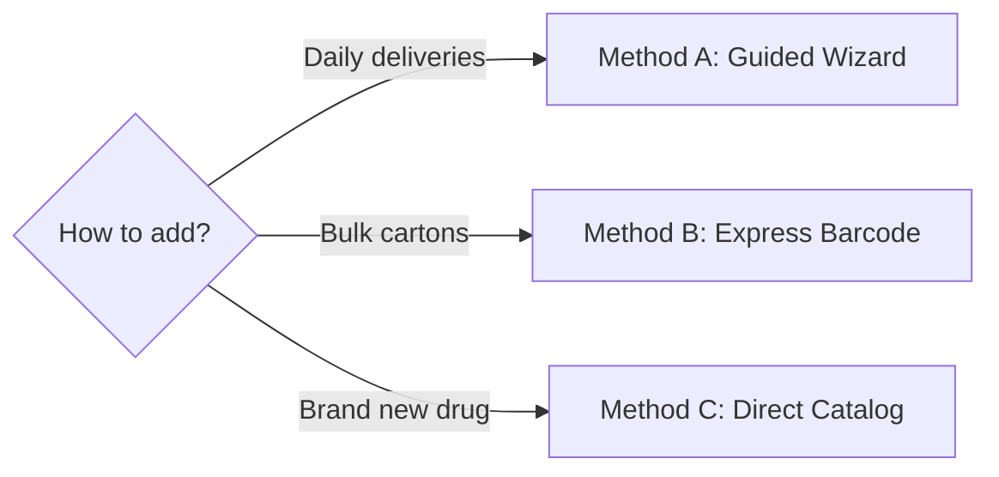

# Dispensary Inventory — How To Use It
# ڈسپنسری انوینٹری سسٹم — استعمال کا طریقہ

| Document Ref | Version & Date | Department | Official Status |
| :--- | :--- | :--- | :--- |
| **GMWF-SOP-MED-01** | Version 1.6.6 · Effective Nov 2026 | Healthcare & Medical Operations | **OFFICIAL OPERATIONAL GUIDE** |

> **Urdu Edition Available:** [GMWF_Dispensary_Inventory_Guide_UR.pdf](file:///d:/Dev/Projects/GMWF/gmwf/guides/pdf/GMWF_Dispensary_Inventory_Guide_UR.pdf)  
> **English Edition Available:** [GMWF_Dispensary_Inventory_Guide_EN.pdf](file:///d:/Dev/Projects/GMWF/gmwf/guides/pdf/GMWF_Dispensary_Inventory_Guide_EN.pdf)

---

## 🎯 Executive Overview & Purpose
This app keeps track of every medicine in the clinic. It works **without internet**, gives out the **oldest-expiry medicine first**, and **records every change**.

> یہ ایپ کلینک کی ہر دوائی کا حساب رکھتی ہے۔ انٹرنیٹ کے بغیر بھی چلتی ہے، پہلے ختم ہونے والی دوائی پہلے دیتی ہے، اور ہر تبدیلی کا ریکارڈ رکھتی ہے۔

---

## ⏱️ IN 30 SECONDS · صرف 30 سیکنڈ میں

| 👁️ Check the pool name first | ✔️ Match the batch on the box | 🔒 Ask for changes — never overwrite |
| :--- | :--- | :--- |
| Confirm you are in `jalalpur_jattan`. | Compare the batch on screen with the physical carton. | Click `[Edit]` to submit a proposal; never type over numbers. |
| *پہلے پول کا نام دیکھیں* | *ڈبے کا بیچ ملائیں* | *تبدیلی کی درخواست دیں* |

---

## 💡 The 3 Big Ideas / تین بنیادی باتیں

1. **Works Offline (انٹرنیٹ نہ ہو تو بھی چلتی ہے):**  
   Save now. The app syncs to the local server and cloud automatically when connection restores.
2. **Oldest Expiry First (پہلے ختم، پہلے خرچ):**  
   The app enforces First-Expiry-First-Out (FEFO) automatically. You just follow the batch shown on screen.
3. **Every Change is Logged (ہر تبدیلی کا ریکارڈ رہتا ہے):**  
   Nobody can quietly change a number. Every movement is recorded with an immutable unique `OpId`.

---

## 🏢 One Pool = One Place's Stock / ایک پول = ایک جگہ کا اسٹاک

```
┌─────────────────────────────────┐           🚫           ┌─────────────────────────────────┐
│       MAIN CLINIC POOL          │   NO DIRECT GIVING     │        FIELD CAMP POOL          │
│        jalalpur_jattan          │ ─────────────────────> │  jalalpur_jattan/flood_relief   │
│  The normal stock of the branch │ Only via logged        │  Every camp has its own         │
│         (برانچ کا عام اسٹاک)        │ transfer movement      │  separate stock (الگ اسٹاک)      │
└─────────────────────────────────┘                        └─────────────────────────────────┘
```
> ہر کلینک کا اپنا الگ اسٹاک پول ہوتا ہے۔ کیمپ کا پول بھی الگ ہوتا ہے۔ ایک پول کی دوائی دوسرے پول میں ٹرانسفر ریکارڈ کے بغیر نہیں دی جا سکتی۔

---

## ⚖️ The 6 Rules That Never Change / 6 اٹل اصول

### Rule 1 · LOGGING: Never Overwrite a Number
You cannot type a new total over the old one. Every change is saved as an audited movement:
- `restock` (نیا سامان وصول ہوا)
- `dispense` (مریض کو دوائی دی گئی)
- `count` (الماری کی فزیکل گنتی)
- `adjust` (نقصان یا برانچ ٹرانسفر)
> *موجودہ تعداد پر نیا نمبر نہیں لکھ سکتے۔ ہر تبدیلی ایک ریکارڈ شدہ حرکت ہوتی ہے۔*  
> **Example:** Stock shows 120. You cannot change it directly to 50. You must record an `adjust` or a `count`.

### Rule 2 · FEFO: Oldest Expiry Goes First
The app picks the batch that expires earliest. Other batches are locked until the earlier batch is depleted.
> *پہلے ختم ہونے والا بیچ پہلے دیا جائے گا۔ باقی بیچ بند رہیں گے۔*  
> **Example:** Batch A expires 2027-04. Batch B expires 2028-01. You must dispense Batch A first.

### Rule 3 · EXPIRY DATE: Expiry is Always the 1st of a Future Month
Dates are saved as `YYYY-MM-01`. The month must be strictly *after* the current month.
> *ایکسپائری ہمیشہ مہینے کی پہلی تاریخ اور آنے والے مہینے کی ہو۔*  
> **Example:** If today is November 2026, `2026-11-01` is rejected. `2026-12-01` is accepted.

### Rule 4 · ZERO FLOOR: Stock Can't Go Below Zero · Reserved is Locked
When the Doctor prescribes medicine during consultation, that quantity is marked `Reserved` so nobody else can give it.
> *ڈاکٹر نسخہ لکھے تو دوائی ریزرو ہو جاتی ہے۔*  
> **Example:** Token #14: 20 Panadol tablets are Reserved. Another patient cannot get those 20.

### Rule 5 · TWO-PERSON: Two-Person Rule for Edits
A Dispenser **cannot** change a medicine's name or formula directly. Clicking `[Edit]` sends a request to `[Pending Requests]`. A Doctor, Branch Manager, or Supervisor approves it.
> *ڈسپنسر نام یا فارمولا خود نہیں بدل سکتا۔ درخواست منظوری کے لیے جاتی ہے۔*

### Rule 6 · ADMIN ONLY: Only Admin Can Wipe a Pool
Wiping a whole pool needs Admin / HQ permission and the security password.
> *پورا پول صاف کرنے کے لیے ایڈمن اختیار اور سیکیورٹی پاس ورڈ چاہیے۔ پاس ورڈ گائیڈ میں نہیں لکھا — ایچ کیو سے لیں۔*

---

## 🖥️ Know Your Screen / اپنی اسکرین کو پہچانیں


### Screen Numbered Legend:
1. **Pool Selector (`[Branch & Camp]`):** Check the pool name here first (`jalalpur_jattan`).  
   *(پہلے یہاں پول کا نام دیکھیں)*
2. **4 Number Tiles:** Formulas · Total Units · Low Stock · Expiring Soon.  
   *(چار خانے: فارمولے، کل یونٹ، کم اسٹاک، جلد ایکسپائر)*
3. **Higher Authority Controls:** Visible only to Chairman, HQ Manager, and Admins. Hidden for Dispensers.  
   *(یہ صرف چیئرمین، ایچ کیو مینیجر اور ایڈمن کو نظر آتا ہے)*
4. **Search Bar:** Search by medicine name, generic formula, or barcode.  
   *(نام، فارمولا یا بارکوڈ سے تلاش کریں)*
5. **Filters:** Choose dosage type (Tablet, Syrup, Injection) and batch filters.  
   *(فلٹر منتخب کریں)*
6. **Medicine Table:** Red name or red number indicates low or zero stock.  
   *(دواؤں کی جدول — سرخ نام یا نمبر کا مطلب کم یا صفر اسٹاک)*

> [!TIP]
> **Dispenser screen is simpler:** The dark button panel (no. 3) is hidden for Dispensers. You use search, filters, the table, and the add-stock tools.  
> *(ڈسپنسر کی اسکرین پر نمبر 3 والا بٹن پینل نظر نہیں آتا)*

---

## ➕ I Want to Add Stock / اسٹاک شامل کرنا

There are 3 operational pathways. Most days you use **Method A** or **Method B**:



- **METHOD A · Guided Wizard (روزانہ آنے والی دوائی کے لیے بہترین):**  
  3 steps: Choose medicine $\rightarrow$ Check batch & expiry $\rightarrow$ Read receipt card $\rightarrow$ Confirm.
- **METHOD B · Express Barcode (بہت سے ڈبے ہوں تو: اسکین کریں):**  
  Switch on `[Express Scan Mode]`. Scan the carton $\rightarrow$ Type count $\rightarrow$ Press Enter. No mouse required.
- **METHOD C · Direct Catalog (بالکل نئی دوائی رجسٹر کرنے کے لیے):**  
  For brand-new medicines. Only Doctors / in-charges register new formulas.

### Method A Summary Receipt Screen:

1. **Medicine with barcode number** *(دوائی اور اس کا بارکوڈ)*
2. **Expiry saved and New stock total** *(ایکسپائری اور نیا اسٹاک)*
3. Press `[+ Add more medicines]` for the next box, or `[Back to inventory]` when finished.

> [!WARNING]
> **Check before you save:** Batch number and expiry on the physical carton must equal what you type. Expiry must be a future month.  
> *(بیچ نمبر اور ایکسپائری ڈبے سے ملا کر لکھیں۔ ایکسپائری آنے والے مہینے کی ہو)*

---

## ✏️ I Want to Change a Medicine's Details / تفصیل درست کرنا


1. **Find the medicine. Press `[Edit]`.** *(دوائی ڈھونڈیں — `[Edit]` دبائیں)*
2. **The `[Request Edit]` window opens.** Correct the mistaken field (Formula, Barcode, Type, Dose, Expiry). *(غلط خانہ درست کریں)*
3. **Write why you need the change.** *(تبدیلی کی وجہ لکھیں)*
4. **Send.** It waits in `[Pending Requests]` until a Doctor, Branch Manager, or Supervisor approves. *(منظوری تک درخواست پینڈنگ میں رہے گی)*

```
┌────────────────────┐     ┌────────────────────┐     ┌────────────────────┐     ┌────────────────────┐
│ 1. Dispenser asks  │ ──> │     2. Waits       │ ──> │3. Approver checks  │ ──> │4. Change goes live │
│ You press Edit and │     │ Sits in Pending    │     │ Doctor, BM or Sup. │     │ Number or name is  │
│ send with reason   │     │ Requests queue     │     │ reviews & approves │     │ updated in database│
└────────────────────┘     └────────────────────┘     └────────────────────┘     └────────────────────┘
```

> [!NOTE]
> **Banner Confirmation:** The top of the dialog reads: *"Changes will be sent for supervisor approval"* — your change is **not live** until approved. Doctors and Branch Managers can use Direct Edit to fix typos immediately.

---

## 🔍 I Want to Check My Stock Count / اسٹاک کی گنتی

- **A · Stock Check (`stock_check_report.dart`):**  
  Fast shelf count. Items marked `[Needs a count]` come first. Type what you physically see on the shelves.  
  *(شیلف پر موجود گولیاں گن کر درج کریں)*
- **B · Medicine Ledger (`medicine_ledger.dart`):**  
  Full chronological history of every movement, with the running balance after each patient token.  
  *(ہر حرکت کا مکمل ریکارڈ — ہر ٹوکن کے بعد کا بیلنس)*

---

## ⚠️ I Found Expired Medicine / ایکسپائر دوائی

- **A · Official Quarantine:**  
  Write off the expired stock. Record the disposal method: **Incineration** or **Return to Supplier**.  
  *(ایکسپائر اسٹاک ضائع کریں اور طریقہ لکھیں: جلانا یا واپسی)*
- **B · Batch Correction:**  
  Was the expiry date typed wrongly during intake? Fix it — a Supervisor must countersign.  
  *(تاریخ غلط لکھی گئی ہو تو درست کریں، سپروائزر کی منظوری ضروری ہے)*

---

## 👥 Who Can Do What / کون کیا کر سکتا ہے

| Action | Dispenser | Receptionist | Doctor | Branch Mgr | Supervisor | Admin / HQ |
| :--- | :---: | :---: | :---: | :---: | :---: | :---: |
| **View catalog & search** | ✅ | ✅ | ✅ | ✅ | ✅ | ✅ |
| **Add stock (Wizard / Express)** | ✅ | ❌ | ✅ | ✅ | ✅ | ✅ |
| **Dispense to patient against token** | ✅ | ❌ | ❌ | ✅ | ✅ | ✅ |
| **Submit medicine edit request** | ✅ | ❌ | ✅ | ✅ | ✅ | ✅ |
| **Approve / reject edit requests** | ❌ | ❌ | ✅ | ✅ | ✅ | ✅ |
| **Physical stock count** | ✅ | ❌ | ✅ | ✅ | ✅ | ✅ |
| **Wipe selected pool (`admin123`)** | ❌ | ❌ | ❌ | ❌ | ❌ | ✅ |

---

## 🏥 3 Situations You Will Meet / تین حالتیں

### A · EMPTY (خالی)
- **Status:** No medicines in stock.
- **Buttons Shown:** `[+ Add First Medicine]` and `[Import Regional Catalog]`.
- **When:** New medical camp or freshly installed branch database.

### B · WORKING (جاری)
- **Status:** Normal outpatient clinic session.
- **Live State:**
  - `Panadol 500mg`: 420 tabs · **20 Reserved** for Token #14.
  - `Brufen 400mg`: 12 tabs · ⚠️ **Low Stock** alert.
  - `Septran DS`: 45 tabs · 🟡 **Near Expiry** (40 days remaining).
  - `Calpol Syrup`: 0 units · 🔴 **Expired** (quarantined).
  - `Amoxil 250mg`: Edit request submitted by Dispenser Tariq, waiting for BM.

### C · COMPLETED (مکمل)
- **Status:** Friday closing and weekly reconciliation.
- **Live State:** Dr. Hamza and BM Asif counted shelves. **0 discrepancies**.
- **Badge:** All audited items display green checkmark `[Confirmed Stock - Audited Today]`. Nexus LAN Server and Cloud are in 100% harmony.


---

## 📌 Quick Reminder / فوری یاد دہانی
1. **Check the pool name:** Make sure you are in `jalalpur_jattan`. *(پول دیکھیں)*
2. **Match the batch:** Compare the screen batch with the physical box. *(بیچ ملائیں)*
3. **Never overwrite a number:** Log adjustments with audited reasons. *(نمبر پر نمبر نہ لکھیں)*
4. **Ask for edits, don't force them:** Use the Two-Man request workflow. *(تبدیلی کی درخواست دیں، زبردستی نہ کریں)*
