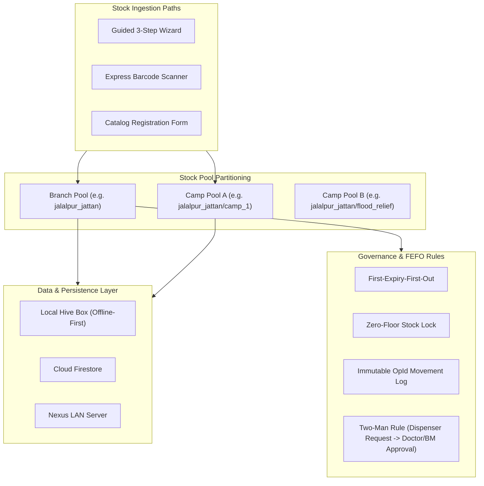
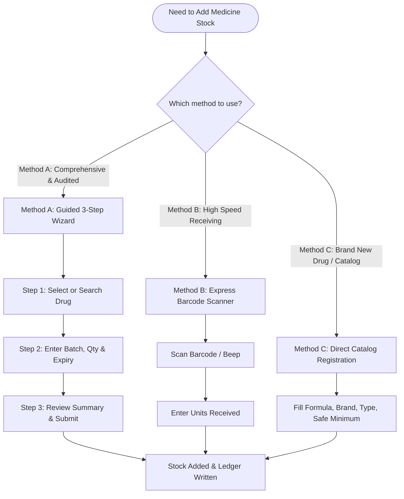
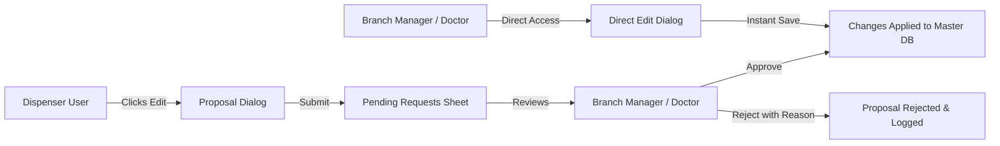

# Dispensary Medicine Inventory System — Master Operational Guide
# ڈسپنسری میڈیسن انوینٹری سسٹم — جامع آپریشنل و صارف رہنما

---

## 📑 Table of Contents / فہرست مضامین
1. [System Overview & Architectural Principles / نظام کا جائزہ اور بنیادی اصول](#1-system-overview--architectural-principles)
2. [Core Inventory Rules & Security Controls / انوینٹری کے بنیادی قوانین اور سیکیورٹی کنٹرولز](#2-core-inventory-rules--security-controls)
3. [Dispensary Inventory Screen Anatomy / انوینٹری اسکرین کا تفصیلی تجزیہ](#3-dispensary-inventory-screen-anatomy)
4. [Multiple Ways to Do Things (Workflows & Alternatives) / کام سرانجام دینے کے مختلف طریقے](#4-multiple-ways-to-do-things-workflows--alternatives)
   - 4.1 [Adding Medicine Stock (3 Methods) / دوائی کا اسٹاک شامل کرنے کے 3 طریقے](#41-adding-medicine-stock-3-methods)
   - 4.2 [Modifying or Editing Medicine Details (2 Methods) / دوائی کی تفصیلات میں تبدیلی کے 2 طریقے](#42-modifying-or-editing-medicine-details-2-methods)
   - 4.3 [Stock Audits & Physical Counts (2 Methods) / فزیکل کاؤنٹ اور اسٹاک آڈٹ کے 2 طریقے](#43-stock-audits--physical-counts-2-methods)
   - 4.4 [Handling Expired & Quarantined Batches / زائد المیعاد اور الگ کی گئی ادویات](#44-handling-expired--quarantined-batches)
5. [Authority Levels & Role Boundaries / اختیارات کے درجات اور کردار](#5-authority-levels--role-boundaries)
6. [Server Control & Master Wipe Tools / سرور کنٹرول اور ماسٹر وائپ ٹولز](#6-server-control--master-wipe-tools)
7. [Jalalpur Jattan Real-World Scenarios / جلال پور جٹاں برانچ کے عملی منظرنامے](#7-jalalpur-jattan-real-world-scenarios)
   - 7.1 [Empty State (نئی برانچ یا خالی اسٹاک)](#71-scenario-a--empty-state)
   - 7.2 [Working / In-Progress State (روزمرہ کام کی حالت)](#72-scenario-b--working--in-progress-state)
   - 7.3 [Worked / Completed State (مکمل تصدیق شدہ حالت)](#73-scenario-c--worked--completed-state)
8. [Visual Reference Screenshots / تصویری رہنما و اسکرین شاٹس](#8-visual-reference-screenshots)
9. [مکمل اردو رہنما (Urdu Complete Guide)](#9-مکمل-اردو-رہنما-urdu-complete-guide)

---

## 1. System Overview & Architectural Principles

The GMWF Dispensary Inventory Subsystem is an enterprise pharmaceutical inventory management engine engineered specifically for humanitarian clinics, base dispensaries, mobile medical camps, and regional distribution networks.



### 1.1 The Stock Pool Architecture
Inventory is strictly partitioned into **Stock Pools**:
- **Standard Branch (No Sub-camps):** Uses a single root pool named after the branch identifier (e.g., `jalalpur_jattan`, `karachi_central`).
- **Branch with Medical Camps:** When a branch establishes temporary field camps, each camp maintains its own independent stock pool formatted as `branchId/campId` (e.g., `jalalpur_jattan/free_eye_camp_2026`).
- **Cross-Pool Isolation:** Medicines in one pool cannot be dispensed by another pool without an explicit, audited transfer movement.

---

## 2. Core Inventory Rules & Security Controls

> [!IMPORTANT]
> All users must adhere to the following non-negotiable system rules. Violations will be rejected by the validation layer and recorded in the audit journal.

### Rule 1: Immutable Movement Logging (Absolute Quantity Overwrite Banned)
Under no circumstances can an operator simply type a new arbitrary stock quantity (e.g. changing 50 to 120 directly in the database). Every quantity adjustment must be executed through a **`StockMovement`** with an immutable unique Operation ID (`opId`):
- `restock`: Delivery of stock from donor, central warehouse, or purchase.
- `dispense`: Dispensing to a patient against an authorized doctor prescription token.
- `count`: Physical audit count adjustment recording the variance (+ or -).
- `adjust`: Controlled management adjustment (e.g., damaged vial write-off).

### Rule 2: FEFO Law (First-Expiry-First-Out)
When a medicine has multiple batches in stock:
- The system automatically serves the batch with the **earliest expiry date**.
- Batches expiring in subsequent years are protected from being dispensed until older batches are depleted.
- Expired batches (`expiryDate <= today`) are automatically quarantined from the shelf and cannot be selected by the doctor.

### Rule 3: Expiry Date Validation Standards
- Every expiry date is normalized to the **first day of the month** (`YYYY-MM-01`).
- The expiry date must be strictly **in a future month**. Registering a medicine expiring in the current month or in the past is blocked with a validation error.

### Rule 4: Zero-Floor & Reservation Protection
- Stock cannot go negative. The system enforces a strict zero floor ($Quantity \ge 0$).
- When a doctor writes a prescription for an active patient token, the requested units are placed in a temporary **Reserved** status. This prevents another doctor or dispenser from dispensing the same physical pills simultaneously. If the consultation is cancelled, the reservation is automatically released.

### Rule 5: Two-Man Rule for Dispensers (Proposal vs Approval)
- Pharmacy Dispensers **cannot** directly edit medicine names, formulas, categories, or wipe stock.
- When a dispenser clicks `[Edit Medicine]`, the system opens a **Request Proposal Dialog**. The dispenser submits the proposed change with a reason.
- The change enters `[Pending Requests]` and takes effect only when a **Branch Manager**, **Supervisor**, or **Doctor** reviews and approves it.

### Rule 6: High Authority Password Gating (`admin123`)
Destructive operations (such as `[Wipe Selected Pool]`, `[Remove by Barcodes]`, and `[Purge Unbarcoded Medicines]`) are completely hidden from regular staff and require higher executive credentials and the security override password:
$$\text{Security Override Password} = \mathbf{admin123}$$

---

## 3. Dispensary Inventory Screen Anatomy

The main dispensary inventory screen ([lib/pages/dispensary/dispensar/inventory.dart](file:///d:/Dev/Projects/GMWF/gmwf/lib/pages/dispensary/dispensar/inventory.dart)) provides an all-in-one control center.


### Key Interface Sections:
1. **Top Control Bar:**
   - **Branch / Camp Selector:** Dropdown showing current branch (e.g., `Jalalpur Jattan`) and active medical camps.
   - **Search Input:** Real-time search across Medicine Brand Name, Generic Formula, and Barcode.
   - **Formula Merge Switch (`Merge by Formula`):** When toggled ON, groups different brands sharing identical chemical formulas (e.g., Panadol, Calpol, and Disprol group under *Paracetamol 500mg*).
   - **Primary Action Buttons:** `[+ Add Medicines]`, `[Stock Check]`, `[Activity Log]`, and `[Pending Requests]`.

2. **Status Filter Chips:**
   - `All`: Total catalog in this pool.
   - `In Stock`: Items with shelf count $> 0$.
   - `Low Stock`: Items nearing the minimum safety threshold ($< 20$ units).
   - `Near Expiry`: Items expiring within the next 90 days.
   - `Expired`: Items that have passed their shelf life (quarantined).

3. **Medicine Data Table:**
   - **Medicine Name & Formula:** Displays brand and generic compound name.
   - **Category Pill:** Tablet, Syrup, Injection, Capsule, Drop, Inhaler, Ointment, Suspension.
   - **Available Quantity:** Real-time net available count.
   - **Batches Chip:** Shows how many distinct physical batches exist.
   - **Quick Action Menu:** `[Add Batch]`, `[View Details]`, `[Audit Count]`, and `[Request Edit]`.


---

## 4. Multiple Ways to Do Things (Workflows & Alternatives)

The GMWF system is intentionally designed with multiple operational pathways so staff can choose the fastest, most convenient method depending on their hardware (barcode scanner vs touchscreen vs keyboard) and authority level.

---

### 4.1 Adding Medicine Stock (3 Methods)



#### Method A: Guided 3-Step Wizard (Recommended for Daily Deliveries)
- **Accessible From:** Click `[+ Add Medicines]` from the top bar of the Inventory Screen.
- **Workflow:**
  1. **Step 1 (Select Medicine):** Search existing medicines by typing 2 or more letters. If the medicine exists, select it. If it is new, choose `[Create New Medicine Entry]`.
  2. **Step 2 (Batch & Quantity):** Enter the manufacturer Batch Number (e.g., `BAT-2026-X4`), physical quantity (tablets/bottles), and pick the Expiry Month/Year.
  3. **Step 3 (Confirmation & Review):** The system displays a receipt card showing:
     - Target Pool (e.g. `Jalalpur Jattan Main`)
     - Previous Stock vs New Projected Stock
     - Calculated Days to Expiry
     - Operator stamp
  4. Click `[Confirm & Record Stock]`.


#### Method B: Express Mode with Barcode Scanner (High-Speed Bulk Ingestion)
- **Best For:** Receiving large shipments of 50+ boxes from central donors.
- **Workflow:**
  1. Plug in any standard USB or Bluetooth 1D/2D Barcode Scanner.
  2. In the `[Add Medicines]` screen, toggle the switch: `[Express Scan Mode]`.
  3. Scan the barcode on the outer carton.
  4. The system matches the barcode immediately. The cursor focuses automatically into the `[Quantity]` box.
  5. Type the received count (e.g., `500`) and press **[Enter]**.
  6. The system beeps affirmatively, saves the stock instantly, and resets the cursor for the next barcode scan without requiring mouse clicks.

#### Method C: Direct Catalog Registration (`inventory_update.dart`)
- **Best For:** Dispensary Incharges and Doctors who want to register brand new pharmaceutical formulations and establish baseline parameters before goods physically arrive.
- **Workflow:**
  1. Open `[Inventory Update & Registration]`.
  2. Fill in the comprehensive master card:
     - Generic Formula (e.g., `Ciprofloxacin 500mg`)
     - Brand Name (e.g., `Ciproxin`)
     - Dosage Form (e.g., `Tablet`)
     - Recommended Minimum Safety Level (e.g., `100`)
     - Default Pack Size (e.g., `10x10 Strips`)
  3. Click `[Save to Master Catalog]`.

---

### 4.2 Modifying or Editing Medicine Details (2 Methods)



#### Method A: Direct Edit (Branch Managers, Supervisors, Doctors)
- Users with management privileges can click `[Edit]` next to any medicine row.
- A dialog opens allowing immediate correction of:
  - Spelling errors in Brand Name
  - Generic Formula classification
  - Minimum safety threshold
- Click `[Save Changes]`. An audit record is written immediately: `medicine_metadata_updated`.

#### Method B: Proposed Request Workflow (Dispensers)
- Dispensers do not have permission to modify master records directly.
- When a dispenser clicks `[Edit]`, the dialog transforms into **[Submit Medicine Edit Request]**.
- The dispenser enters the suggested changes along with an explanation in the `[Reason for Request]` box (e.g., *"Package indicates 250mg syrup, not 125mg"*).
- The request appears in the top navigation badge: `[Pending Requests]`.


- **Reviewing Requests:**
  1. Branch Manager or Doctor opens `[Pending Requests]`.
  2. The dialog lists:
     - Who requested the change (Dispenser Name + Timestamp)
     - Current Values vs Proposed Values (highlighted in amber/green)
     - Reason notes
  3. The reviewer clicks `[Approve]` or enters a rejection note and clicks `[Reject]`.

---

### 4.3 Stock Audits & Physical Counts (2 Methods)

Discrepancies between physical shelf counts and system counts must be audited periodically.

#### Method A: Quick Stock Check Report (`stock_check_report.dart`)
- Click `[Stock Check]` from the inventory toolbar.
- The screen lists all medicines requiring routine verification:
  - `Needs a count`: Medicines not counted in the last 30 days.
  - `Discrepancy Detected`: Medicines where recent dispense volume diverges from ledger expectations.
- The staff member enters the actual number counted on the shelf in `[Physical Count]`.
- If physical equals system count, click `[Confirm Match]` (marked verified).
- If physical differs, the system calculates the variance $\Delta = \text{Count} - \text{System}$ and prompts for an audit note before posting a `count` movement.

#### Method B: Comprehensive Medicine Ledger (`medicine_ledger.dart`)
- Click `[Medicine Ledger]` to view a complete financial-grade audit ledger for any specific drug over time.
- Displays a running balance ledger:
  $$\text{Closing Balance} = \text{Opening Balance} + \text{Restock} - \text{Dispensed} \pm \text{Adjustments}$$
- Every line displays the exact Doctor Consultation Token, Patient Name, Dispenser, and Timestamp.

---

### 4.4 Handling Expired & Quarantined Batches

The system monitors batch shelf-life continuously:
1. **Yellow Warning Badge (`Near Expiry`):** Appears when a batch has less than 90 days remaining. Staff should prioritize dispensing this batch or alert physicians to utilize it first.
2. **Red Warning Badge (`Expired`):** Appears when today's date exceeds the batch expiry date.
   - The batch is immediately removed from the doctor's active prescription dropdown.
   - The available shelf count drops automatically.
3. **Disposal & Write-Off Procedure:**
   - Open `[Expiry Management]` (`expiry_page.dart`).
   - Select the expired batch.
   - Click `[Dispose / Write-Off Batch]`.
   - Select disposal method: *Incineration*, *Returned to Supplier*, or *Chemical Neutralization*.
   - Upload or sign the disposal authorization; stock is removed with zero-risk to patients.

---

## 5. Authority Levels & Role Boundaries

| Action / Capability | Dispenser | Receptionist | Doctor | Branch Manager | Supervisor | HQ Manager / Admin |
| :--- | :---: | :---: | :---: | :---: | :---: | :---: |
| View Medicine Catalog & Search | ✅ | ✅ | ✅ | ✅ | ✅ | ✅ |
| Add Stock (Guided Wizard) | ✅ | ❌ | ✅ | ✅ | ✅ | ✅ |
| Add Stock (Express Barcode) | ✅ | ❌ | ✅ | ✅ | ✅ | ✅ |
| Dispense to Patients against Token | ✅ | ❌ | ❌ | ✅ | ✅ | ✅ |
| Prescribe Medicines (Reserves Stock) | ❌ | ❌ | ✅ | ❌ | ❌ | ❌ |
| Submit Medicine Edit Request | ✅ | ❌ | ✅ | ✅ | ✅ | ✅ |
| Approve / Reject Edit Requests | ❌ | ❌ | ✅ | ✅ | ✅ | ✅ |
| Perform Physical Stock Count | ✅ | ❌ | ✅ | ✅ | ✅ | ✅ |
| Dispose / Write-Off Expired Stock | ❌ | ❌ | ✅ | ✅ | ✅ | ✅ |
| Wipe Selected Pool (`admin123`) | ❌ | ❌ | ❌ | ❌ | ❌ | ✅ |
| Remove Unbarcoded Medicines | ❌ | ❌ | ❌ | ❌ | ❌ | ✅ |

---

## 6. Server Control & Master Wipe Tools

For system administrators and disaster recovery teams, the system provides high-grade maintenance tools accessible from the **Nexus Server Dashboard** (`nexus_more_views.dart`).

> [!CAUTION]
> Master wipe operations are irreversible. They purge stock pools, reset batch journals, and clear cached counters. Always ensure a cloud backup exists prior to running these tools.

### 6.1 Wipe Selected Pool
- **Tool Location:** Nexus Server Dashboard $\rightarrow$ Advanced Tools $\rightarrow$ `[Wipe Selected Pool]`.
- **Purpose:** Used when a temporary medical camp concludes its operations or when a branch is completely decommissioned.
- **Security Check:** Requires typing the branch ID and the master password: `admin123`.

### 6.2 Remove by Barcodes
- Allows bulk decommission of recalled drug batches by scanning or pasting a list of batch barcodes.
- The system flags all matching rows across all branch pools and safely moves them to the quarantined archive.

### 6.3 Remove Unbarcoded Medicines
- Cleans legacy test data or placeholder entries entered during initial pilot phases that lack standard GS1/EAN barcodes.

---

## 7. Jalalpur Jattan Real-World Scenarios

To help clinic staff and branch operators understand how the screen looks and behaves at different times of the day, here are three concrete scenarios from the **Jalalpur Jattan Branch** (`jalalpur_jattan`).

---

### 7.1 Scenario A — Empty State
**Context:** The Jalalpur Jattan branch has just opened its new rural eye and maternal health wing, or a newly deployed local database has zero records.

#### Visual Appearance:
- The screen shows the standard GMWF clean empty illustration (`GEmptyIllustration`).
- **Main Heading:** *"No Medicines in Stock"*
- **Sub-caption:** *"This stock pool (jalalpur_jattan) has no recorded medicines. Add inventory using the guided wizard or scan incoming stock cartons."*
- **Call-to-Action Buttons:**
  - `[+ Add First Medicine]` (Opens Guided 3-Step Wizard)
  - `[Import Regional Catalog]` (Loads standard 120 GMWF essential drug formulary)

#### Sample State Data:
```json
{
  "branchId": "jalalpur_jattan",
  "pool": "jalalpur_jattan",
  "totalItems": 0,
  "inStock": 0,
  "lowStock": 0,
  "nearExpiry": 0,
  "expired": 0,
  "pendingRequests": 0
}
```

---

### 7.2 Scenario B — Working / In-Progress State
**Context:** Typical Tuesday morning at Jalalpur Jattan. 40 patients have registered at reception. The dispenser has just unpacked a fresh delivery of antibiotics, two items are running low, and an edit request is awaiting approval.

#### Visual Appearance:
- **Search & Filter Bar:** Shows badges: `All (14)`, `In Stock (12)`, `Low Stock (2)`, `Near Expiry (1)`, `Expired (1)`.
- **Pending Requests Pill:** Displays an amber badge `[Requests: 1]`.
- **Medicine Table Rows:**

| Medicine Name | Generic Formula | Category | Available | Shelf Batches | Expiry Status | Live Action |
| :--- | :--- | :--- | :--- | :--- | :--- | :--- |
| **Panadol 500mg** | Paracetamol | Tablet | 420 | 2 batches (`BAT-P1`, `BAT-P2`) | Valid (Nov 2027) | `[+ Add Batch]` |
| **Amoxil 250mg** | Amoxicillin | Capsule | 85 | 1 batch (`AMX-88`) | Valid (Aug 2027) | `[+ Add Batch]` |
| **Brufen 400mg** | Ibuprofen | Tablet | **12** | 1 batch (`BRF-04`) | ⚠️ **Low Stock** | `[Restock Now]` |
| **Septran DS** | Co-trimoxazole | Tablet | 45 | 1 batch (`SEP-01`) | 🟡 **Near Expiry** (42 Days) | `[Prioritize]` |
| **Flagyl 400mg** | Metronidazole | Tablet | 160 | 1 batch (`FLG-99`) | Valid (Jan 2028) | `[+ Add Batch]` |
| **Calpol 120mg/5ml** | Paracetamol | Syrup | **0** | 1 batch (`CLP-09`) | 🔴 **Expired** (Quarantined) | `[Write-Off]` |

#### Active In-Flight Workflows:
1. **Pending Reservation:** 2 strips (20 tablets) of *Panadol 500mg* are highlighted in light blue indicating they are **Reserved** for Patient Token #14 currently in Doctor Room 1.
2. **Pending Edit Request:** Dispenser Tariq submitted an edit request:
   - *Target Drug:* `Amoxil 250mg`
   - *Proposal:* Change category from `Tablet` to `Capsule`
   - *Reason:* *"Box mislabeled at registration; physically inspected as blister capsules."*
   - *Status:* Awaiting Branch Manager approval.

---

### 7.3 Scenario C — Worked / Completed State
**Context:** End of the week at Jalalpur Jattan (Friday afternoon 4:00 PM). Weekly physical audit completed, all pending requests resolved, expired stocks safely written off, and physical counts reconciled.

#### Visual Appearance:
- **Pending Requests Badge:** Displays `[No Pending Requests]` with clean illustration.
- **Activity Log Sheet:** Shows full timestamped log of all movements executed today.
- **Stock Audit Status:** All items display a green checkmark `[Confirmed Stock - Audited Today]`.
- **Discrepancy Counter:** `0 Discrepancies`.
- **System Indicator:** Green status bar *"Local Hive Cache synchronized with Cloud Firestore & Nexus Server."*

#### Sample Completed Audit Record:
```json
{
  "branchId": "jalalpur_jattan",
  "auditDate": "2026-11-21",
  "auditedBy": "Dr. Hamza / BM Asif",
  "itemsVerified": 14,
  "matchedCount": 14,
  "discrepancies": 0,
  "quarantinedDisposed": 1,
  "closingStockTotalUnits": 2845,
  "status": "RECONCILED_AND_LOCKED"
}
```

---

## 8. Visual Reference Screenshots

The following reference captures illustrate actual system screens for quick operational recognition:

### Overview & Activity Logs
- **Main Inventory View:** [ref_med_inventory_overview.jpg](file:///d:/Dev/Projects/GMWF/gmwf/guides/modules/02_dispensary/inventory/screenshots/ref_med_inventory_overview.jpg)  
  *Shows the complete layout, search bar, filter tabs, and action toolbar.*
- **Medicine Table Rows:** [ref_medicine_table_rows.png](file:///d:/Dev/Projects/GMWF/gmwf/guides/modules/02_dispensary/inventory/screenshots/ref_medicine_table_rows.png)  
  *Demonstrates high-contrast rows, batch counts, and stock level indicators.*
- **Activity Log Empty State:** [ref_inventory_activity_log_empty.png](file:///d:/Dev/Projects/GMWF/gmwf/guides/modules/02_dispensary/inventory/screenshots/ref_inventory_activity_log_empty.png)  
  *Shows how the activity drawer appears before movements are committed.*

### Guided Add & Edit Approvals
- **Add Medicine Completion Step:** [ref_add_medicine_done_step.jpg](file:///d:/Dev/Projects/GMWF/gmwf/guides/modules/02_dispensary/inventory/screenshots/ref_add_medicine_done_step.jpg)  
  *Shows the final receipt card and confirmation button.*
- **Dispenser Edit Request Dialog:** [ref_edit_medicine_request_dialog.png](file:///d:/Dev/Projects/GMWF/gmwf/guides/modules/02_dispensary/inventory/screenshots/ref_edit_medicine_request_dialog.png)  
  *Illustrates the two-man approval submission interface.*
- **Pending Requests Empty State:** [ref_pending_requests_empty.png](file:///d:/Dev/Projects/GMWF/gmwf/guides/modules/02_dispensary/inventory/screenshots/ref_pending_requests_empty.png)  
  *Shows the zero-pending confirmation state.*

---

## 9. مکمل اردو رہنما (Urdu Complete Guide)

### 9.1 نظام کا تعارف اور اصول
گلزار مدینہ ویلفیئر فاؤنڈیشن (GMWF) کا ڈسپنسری میڈیسن انوینٹری سسٹم جدید فارماسیوٹیکل اصولوں پر تیار کیا گیا ہے۔ یہ سسٹم آف لائن فرسٹ (Offline-First) بنیادوں پر کام کرتا ہے یعنی انٹرنیٹ منقطع ہونے کی صورت میں بھی ڈسپنسری کا کام نہیں رکتا۔

### 9.2 انوینٹری کے بنیادی اور سخت قوانین
1. **اسٹاک میں براہ راست ردوبدل پر پابندی:** کوئی بھی صارف بغیر ریکارڈ کے اسٹاک کی تعداد خود سے نہیں بدل سکتا۔ ہر تبدیلی ایک باقاعدہ `StockMovement` کے ذریعے ریکارڈ ہوتی ہے جس کا ایک مخصوص `opId` ہوتا ہے۔
2. **پہلے میعاد ختم، پہلے اخراج (FEFO اصول):** جس دوائی کی میعاد (Expiry) سب سے پہلے ختم ہو رہی ہوگی، سسٹم مریض کو سب سے پہلے وہی بیچ جاری کرے گا۔
3. **ایکسپائری کی تاریخ کا قانون:** دوائی کا اندراج کرتے وقت تاریخ ہمیشہ مستقبل کے مہینے کی ہونی چاہیے۔ موجودہ مہینے یا ماضی کی تاریخ پر سسٹم دوائی رجسٹر نہیں کرے گا۔
4. **زیرو فلور قانون (Zero-Floor Rule):** اسٹاک کبھی بھی منفی (Negative) میں نہیں جا سکتا۔
5. **مریض کے لیے ریزرویشن:** جب ڈاکٹر کسی مریض کے ٹوکن پر نسخہ لکھتا ہے تو وہ گولیاں فوری طور پر ریزرو ہو جاتی ہیں تاکہ کوئی دوسرا ڈسپنسر انہی گولیوں کو غلطی سے کسی اور مریض کو نہ دے سکے۔
6. **ڈسپنسر کے اختیارات اور ٹو مین رول (Two-Man Rule):** ڈسپنسر کسی دوائی کا نام یا بنیادی فارمولا براہ راست تبدیل نہیں کر سکتا۔ وہ تبدیلی کی درخواست (Edit Request) بھیجے گا جسے برانچ مینیجر، سپروائزر یا ڈاکٹر منظور کریں گے۔

### 9.3 کام کرنے کے مختلف طریقے (Workflows)

#### طریقہ نمبر 1: نیا اسٹاک شامل کرنے کے 3 طریقے
- **طریقہ الف: 3 مراحل پر مشتمل گائیڈڈ وزرڈ (`[+ Add Medicines]`):**
  - مرحلہ 1: دوائی کا نام تلاش کریں یا نئی دوائی کا انتخاب کریں۔
  - مرحلہ 2: مینوفیکچرر کا بیچ نمبر، ایکسپائری مہینہ/سال اور کل مقدار درج کریں۔
  - مرحلہ 3: خلاصہ چیک کریں اور `[Confirm & Record Stock]` دبائیں۔
- **طریقہ ب: ایکسپریس بارکوڈ اسکینر موڈ:**
  - اسکرین پر `[Express Scan Mode]` آن کریں۔
  - ڈبے پر موجود بارکوڈ اسکین کریں، فوری تعداد لکھیں اور انٹر دبائیں۔ ماؤس چھوئے بغیر 100 ڈبے منٹوں میں رجسٹر ہو جاتے ہیں۔
- **طریقہ ج: ڈائریکٹ رجسٹریشن کیٹلاگ (`inventory_update.dart`):**
  - انچارج حضرات نئی دوائی کا فارمولا، کیٹیگری اور محفوظ اسٹاک کی حد پیشگی طور پر رجسٹر کر سکتے ہیں۔

#### طریقہ نمبر 2: دوائی کی تفصیلات میں تبدیلی کے 2 طریقے
- **طریقہ الف (مینیجر اور ڈاکٹرز):** براہ راست `[Edit]` پر کلک کر کے فوری درستگی کریں جو فوراً سسٹم میں لاگو ہو جاتی ہے۔
- **طریقہ ب (ڈسپنسرز):** ڈسپنسر ترمیم کر کے `[Submit Medicine Edit Request]` میں وجہ لکھے گا۔ یہ درخواست `[Pending Requests]` میں جائے گی جہاں مجاز افسر اسے منظور یا مسترد کرے گا۔

#### طریقہ نمبر 3: اسٹاک کی فزیکل پڑتال (2 طریقے)
- **طریقہ الف (اسٹاک چیک رپورٹ):** الماری میں موجود گولیوں کو گن کر `[Physical Count]` میں لکھیں۔ اگر دونوں برابر ہوں تو `[Confirm Match]` دبائیں۔ فرق ہونے پر سسٹم آڈٹ وجوہات مانگے گا۔
- **طریقہ ب (میڈیسن لیجر):** دوائی کی مکمل تاریخ، کس مریض کو کتنی گولیاں کس وقت دی گئیں، ایک اکاؤنٹنگ لیجر کی طرح تفصیل سے دیکھیں۔

---

### 9.4 جلال پور جٹاں برانچ کے 3 عملی منظرنامے (Sample Data)

#### منظرنامہ 1: بالکل خالی اسٹاک (Empty State)
- نئی برانچ کھلنے پر اسکرین پر خوشنما تصویر اور پیغام آئے گا: *"No Medicines in Stock"*.
- نیچے دو بٹن ہوں گے: `[+ Add First Medicine]` اور `[Import Regional Catalog]`.

#### منظرنامہ 2: عام کام کی حالت (Working / In-Progress State)
- برانچ میں مریض موجود ہیں۔
- پیناڈول (Panadol 500mg) کے 420 دانے موجود ہیں جن میں سے 20 دانے ٹوکن نمبر 14 کے لیے نیلے رنگ میں **Reserved** نظر آ رہے ہیں۔
- بروفین (Brufen 400mg) کی 12 گولیاں رہ جانے پر سرخ رنگ میں **Low Stock** کی وارننگ آ رہی ہے۔
- سیپٹران (Septran DS) پر پیلے رنگ میں **Near Expiry** کا بیج ہے کیونکہ اس کے ختم ہونے میں صرف 42 دن باقی ہیں۔
- کیلیپول شربت (Calpol Syrup) کی میعاد گزر چکی ہے، وہ خودکار طور پر الگ (Quarantined) ہو چکا ہے اور ڈاکٹر اسے نسخے میں منتخب نہیں کر سکتا۔
- اوپر `[Pending Requests: 1]` کا بیج چمک رہا ہے جس میں ڈسپنسر طارق کی طرف سے ایموکسل کیپسول کی تصحیح کی درخواست زیرِ التواء ہے۔

#### منظرنامہ 3: مکمل اور تصدیق شدہ حالت (Worked / Completed State)
- جمعہ کی شام آڈٹ مکمل ہو چکا ہے۔
- تمام اشیاء کے سامنے سبز رنگ کا نشان `[Confirmed Stock - Audited Today]` موجود ہے۔
- زیر التواء درخواستوں کی تعداد 0 ہو چکی ہے۔
- تمام کھاتے کلاؤڈ اور لوکل سرور کے ساتھ مکمل سنکرونائز (Synchronized) ہیں۔
